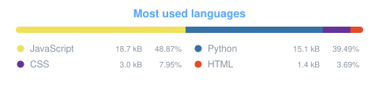

  

<h3 align="center">➜ ɞ Hello there! ♡</h3>

 

·· I'm a **Data Analyst** who enjoys working where engineering meets business ⊹₊˚ 
making sure data is collected correctly, understood clearly and turned into decisions people can act on.

♡ Today I'm on the **Data & Analytics** team at **Monks** — I design tracking plans, implement tags in GTM, validate GA4 and media conversions, and investigate when the numbers don't add up 🔍 
♡ **10+ brands** supported, including Nubank, Smart Fit, Ultragaz, Moura, EDP and Clara 
♡ Tracking across **3 countries** 🇧🇷 🇨🇴 🇲🇽 · **3+ years** building software and working with data 
♡ Before analytics: embedded systems (Python + SQL around sensor data) and front-end in React at Mackenzie's software lab — so I understand how data is **generated, engineered and used** ✧

 

**✦ projects I'm proud of**

- Tracking & page mapping for **Nubank's** institutional site relaunch, feeding its Newsroom and Careers dashboards
- An **AI chat that queries BigQuery** in natural language, with a security layer that blocks unsafe AI-generated SQL
- Automated monitoring with **Playwright** + attribution tracking for a LATAM fintech across 3 countries
- **Black Friday** tracking readiness for a major retail client

 

**✦ toolkit**

`GTM` · `GA4` · `Meta / Google / TikTok Ads` · `Floodlight / SA360` · `BigQuery` · `SQL` · `Looker Studio` · `Power BI` · `Python` · `Django` · `React` · `JavaScript` · `Playwright`

 

  

 

<h3 align="center">➜ ɞ Here's more about me! ♡</h3>

 

♡ I love combining technology with projects that bring me back to the real world and make an impact on the environment 🌱 
♡ Foxes are my favorite animal 🦊 
♡ I love learning new languages — currently French! bonjour ! 🇫🇷 
♡ In my free time: competitive games 🎮 and the gym 🏋️ 
・ ・ ⊹ ₊˚ ♡

 

   
   
   
  

 

<b>ɞ Always open to connecting with people in data, analytics and AI — feel free to reach out! ✉️</b>

